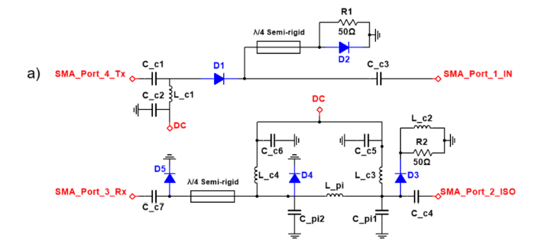
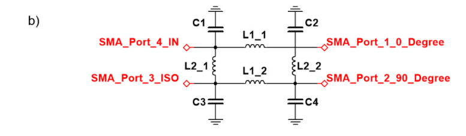

# Modular Multinuclear RF Front Ends

Hardware design files for interchangeable, nucleus-specific RF front-end drawers for **¹H, ²³Na, and ³¹P MRI and spectroscopy at 3T**.

The project uses frequency-specific transmit/receive (T/R) switches, quadrature hybrids, and commercial low-noise preamplifiers in removable drawers. A shared housing allows the front end to be reconfigured for a different nucleus by replacing the drawer. Individual shielding enclosures surround the RF components.

## Research context

Developed by Atakan Ozfidan, Jacob Degitz, Aaliyah K Fisher, Alexander Davis, Travis Carrell, and Mary P McDougall, Texas A&M University.

The approach addresses the need for narrowband front-end components when working with multiple nuclei. Each drawer combines a T/R switch, a quadrature hybrid, and a WanTcom preamplifier: WMM123P for ¹H, WMM32P for ²³Na, and WMM50P for ³¹P. The hardware uses 3D-printed PLA enclosures lined with copper tape and a sliding common housing.

Independent benchtop characterization demonstrated functionality of the T/R switches and quadrature hybrids. Validation with RF coils and imaging or spectroscopy acquisitions remains necessary to establish integrated performance. The design files here should be understood in that research context.

## Repository contents

| Folder | Contents |
| --- | --- |
| [`1_H/`](1_H/) | Proton front-end drawer and assembly, T/R switch circuit and shield, quadrature combiner circuit and shield, and preamplifier shield. |
| [`23_Na/`](23_Na/) | Sodium front-end drawer and assembly, T/R switch circuit and shield, quadrature combiner circuit and shield, and preamplifier shield. |
| [`31_P/`](31_P/) | Phosphorus front-end drawer and assembly, T/R switch circuit and shield, quadrature combiner circuit and shield, and preamplifier shield. |
| [`Common Housing/`](Common%20Housing/) | Shared housing bodies, dowels, assembly, and manufacturing exports. |
| [`Preamplifier_Mounting_Board/`](Preamplifier_Mounting_Board/) | KiCad project for the preamplifier mounting board. |

Within each nucleus folder, `Front_End` contains mechanical drawer designs, `TR_Switch` contains the switch circuit and enclosure, `Quad_Combiner` contains the quadrature hybrid circuit and enclosure, and `Preamp_Shield` contains the preamplifier enclosure. Folder prefixes and spelling vary slightly between nuclei; the original names are preserved.

### File formats

- **KiCad:** `.kicad_pro` projects, `.kicad_sch` schematics, and `.kicad_pcb` board layouts.
- **SolidWorks:** `.SLDPRT` parts and `.SLDASM` assemblies.
- **Manufacturing exports:** `.STL` meshes and selected `.3mf` files for fabrication workflows.

The current tree contains circuit and mechanical design files. Standalone bills of materials, characterization datasets, fabrication instructions, and acquisition software are not currently included.

## Materials list

The following tables list the circuit components, preamplifiers, and assembly materials for each nucleus. Consult the corresponding schematics and assemblies for component counts and placement.

### T/R switch

These parts are common to the ¹H, ²³Na, and ³¹P switch circuits.

| Component | Manufacturer | Part number |
| --- | --- | --- |
| Resistor | Vishay | `PCNM2512E49R9BST5` |
| PIN diode | MACOM | `MA4P7470F-1072T` |
| DC-blocking capacitor | Murata | `GRM32D5C2J183JWA1L` |
| SMA jack | Cinch Connectivity Solutions | `142-9701-801` |
| SMB jack | Cinch Connectivity Solutions | `131-9701-301` |

The following switch components depend on the nucleus:

| Component | Manufacturer | ¹H | ²³Na | ³¹P |
| --- | --- | --- | --- | --- |
| RF-blocking inductor | Coilcraft | `1812CS-322GE` | `1812CS-123GE` | `1812CS-822GE` |
| λ/4 inductor | Coilcraft | `1515SQ-68NG` | `2222SQ-271G` | `2222SQ-161G` |
| λ/4 capacitor | Passive Plus | `1111C270JP152X` | `1111C101JP152X` | `1111C620JP152X` |

The quarter-wave transmission-line sections use 2.2 mm diameter EZ-86 semi-rigid coaxial cable (`EZ-86CuLM17`, EZ Form). Cable lengths are not included in this materials list.

### Quadrature hybrid / combiner

L1 and L2 correspond to the inductor labels in the circuit diagram above.

| Component | Manufacturer | ¹H | ²³Na | ³¹P |
| --- | --- | --- | --- | --- |
| Inductor, L1 | Coilcraft | `1515SQ-47NG` | `2222SQ-181G` | `2222SQ-111G` |
| Inductor, L2 | Coilcraft | `1515SQ-68NG` | `2222SQ-271G` | `2222SQ-161NG` |
| Capacitor | Passive Plus | `1111C620JP152X` | `1111C241JP601X` | `1111C151JP102X` |

**Part-number check:** The ³¹P λ/4 switch inductor is listed as `2222SQ-161G` and the ³¹P combiner L2 inductor as `2222SQ-161NG`. The suffixes differ; confirm the intended parts against the design files before ordering.

### Low-noise preamplifiers

| Nucleus | Manufacturer | Model |
| --- | --- | --- |
| ¹H | WanTcom | `WMM123P` |
| ²³Na | WanTcom | `WMM32P` |
| ³¹P | WanTcom | `WMM50P` |

### Shared mechanical and interconnect materials

The drawers, shielding enclosures, and common housing use the following materials:

| Material / component | Specification or part number | Manufacturer / supplier |
| --- | --- | --- |
| Printing filament | 1.75 mm PLA+ | ELEGOO |
| Internal shielding | Copper tape | Not specified |
| Internal RF cable | RG-58 A/U | Belden |
| External transmit connector | `132170` | Amphenol RF |
| External receive connector | `142-0701-551` | Mouser Electronics (supplier) |
| External DC-bias connector | `142250` | Amphenol RF |
| Coil-facing cable glands | Two PG7 glands for the 0° and 90° quadrature connections | Not specified |

The mechanical parts were fabricated using a Bambu Lab P1S printer. This materials list does not include an independently verified purchasing BOM for the preamplifier mounting board.

## Working with the designs

1. Choose the nucleus-specific folder for your application.
2. Open a circuit's `.kicad_pro` file in KiCad to inspect its schematic and PCB layout. Inspected board files identify KiCad 9.0 as their generator; use a compatible version.
3. Open the SolidWorks parts and assemblies to inspect or modify the mechanical design. Preserve the folder structure so assembly references can resolve.
4. Use the supplied STL or 3MF exports in a compatible slicer when preparing parts for printing. Confirm dimensions, fit, material, shielding, and assembly requirements for your hardware before fabrication.

The preamplifiers are commercial components; the repository includes their enclosure designs and a separate mounting-board project.

## Design background

The T/R switch design is adapted from B. Thapa et al., *Design and Development of a General-Purpose Transmit/Receive (T/R) Switch for 3T MRI, Compatible for a Linear, Quadrature and Double-Tuned RF Coil* (2016), and the quadrature hybrid design as adapted from *NMR Probeheads for Biophysical and Biomedical Experiments*.

## Version-control housekeeping

The `.gitignore` excludes the local reference PDF, Windows and macOS metadata, editor temporary files, SolidWorks temporary lock files, and KiCad local settings, caches, autosaves, and backup directories. Editable design sources and STL/3MF exports are retained.
